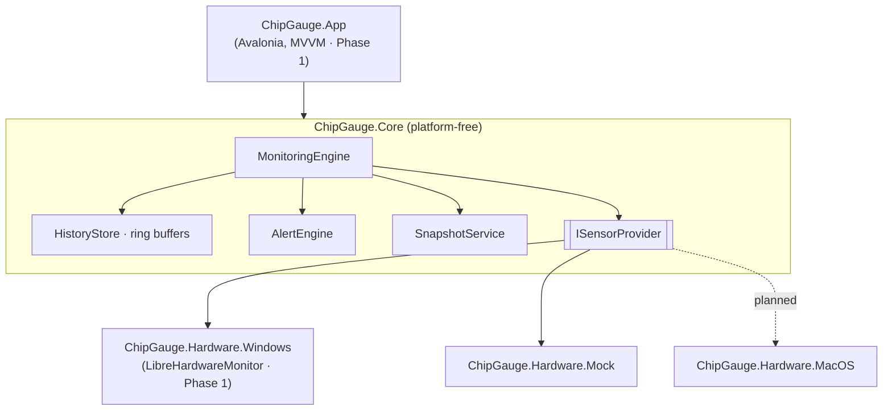

<div align="center">


# ChipGauge

**Real-time hardware monitoring for your desktop.**
One application that unifies what you'd otherwise open five tools to see —
CPU internals, GPU sensors, live performance graphs, full system inventory, and
drive health.

[](https://github.com/paradocx96/system-app/actions/workflows/ci.yml)
[](https://github.com/paradocx96/system-app/actions/workflows/codeql.yml)

-0EA5E9)


</div>

---

> **Project status — Phase 0 (Foundation).**
> The platform-independent monitoring engine, the simulated hardware provider,
> the test suite, CI, and branding are in place and green. The Avalonia desktop
> UI and the live Windows sensor provider land in Phase 1. See the
> [roadmap](#roadmap) and the full [architecture & development plan](docs/PLAN.md).

## Why ChipGauge

Enthusiasts and technicians juggle a drawer full of utilities: CPU-Z for CPU
identification, GPU-Z for the graphics card, CrystalDiskInfo for drive health,
HWiNFO64 for the full sensor list, Speccy for an inventory, and Task Manager for
the live graphs. ChipGauge brings all of that into **one modern, fast, themeable
application** with a summary dashboard, per-category deep dives, and live charts.

| Inspiration | What ChipGauge brings in |
|-------------|--------------------------|
| **CPU-Z** | CPU name, codename, socket, lithography, caches, instruction sets; board & memory details |
| **GPU-Z** | GPU identification, VBIOS/driver, clocks, VRAM usage, temperature, fan, board power |
| **CrystalDiskInfo** | Per-drive S.M.A.R.T. attributes, health verdict, temperature, power-on hours, TBW |
| **HWiNFO64** | The complete sensor tree with current / min / max / average and threshold alerts |
| **Speccy** | A single system inventory, exportable as a shareable snapshot report |
| **Task Manager** | At-a-glance dashboard tiles and 60-second scrolling performance graphs |

## Features

**Available now (engine, Phase 0)**

- ⚙️ **Monitoring engine** — background sampler with a pluggable provider seam, one
  batched update per tick, resettable min/max/average per sensor.
- 📈 **Allocation-free history** — fixed-capacity ring buffers per sensor feed the
  Task-Manager-style scrolling charts without churning garbage on the hot path.
- 🚨 **Alerts** — duration-aware threshold rules ("CPU > 90 °C for 10 s") with
  edge-triggered fire/clear events.
- 💽 **S.M.A.R.T. health** — CrystalDiskInfo-style Good / Caution / Bad verdict logic.
- 📝 **Snapshot export** — deterministic, culture-invariant system report.
- 🧪 **Mock provider** — a deterministic simulated machine for demos, screenshots
  and CI (no elevated hardware access required).

**Planned (UI & live data, Phase 1+)**

- 🖥️ Dashboard of live tiles + category views (CPU, GPU, Memory, Storage, Network,
  Mainboard, Sensors).
- 🎨 Fluent 2 design, dark/light theme with system detection, smooth chart animation.
- 🌍 English + German (Deutsch), switchable at runtime.
- 🔔 Tray mode, CSV logging, auto-update installer.

## Architecture

Strict layering keeps hardware access out of the UI and platform code out of the
core — which is what makes the planned macOS port a new *provider*, not a rewrite.



Full rationale, the framework decision, and the screen-by-screen UI spec are in
[`docs/PLAN.md`](docs/PLAN.md).

## Tech stack

| Concern | Choice |
|---------|--------|
| Runtime | .NET 10 (LTS) |
| UI (Phase 1) | Avalonia UI 11 · Fluent 2 · Skia |
| Sensors (Windows, Phase 1) | LibreHardwareMonitorLib + WMI |
| Tests | xUnit v3 · coverlet |
| CI/CD | GitHub Actions · CodeQL · Dependabot |
| Packaging (Phase 1) | Velopack (delta auto-update) |

## Project structure

```
ChipGauge.slnx
├── src/
│   ├── ChipGauge.Core/            # models, engine, history, alerts, SMART, reporting (no platform code)
│   ├── ChipGauge.Hardware.Mock/   # deterministic simulated provider
│   ├── ChipGauge.Hardware.Windows # LibreHardwareMonitor provider (Phase 1)
│   └── ChipGauge.App/             # Avalonia desktop UI (Phase 1)
├── tests/
│   └── ChipGauge.Core.Tests/      # xUnit test suite
├── assets/                        # brand SVGs + generated icons/banner
├── build/                         # icon generation script
├── docs/                          # architecture & development plan
└── .github/workflows/             # CI, CodeQL
```

## Getting started

### Prerequisites

- [.NET 10 SDK](https://dotnet.microsoft.com/download/dotnet/10.0) (LTS)

### Build & test

```bash
git clone https://github.com/paradocx96/system-app.git
cd system-app

dotnet restore ChipGauge.slnx
dotnet build   ChipGauge.slnx -c Release
dotnet test    ChipGauge.slnx -c Release
```

### Check formatting (as CI does)

```bash
dotnet format ChipGauge.slnx --verify-no-changes
```

### Regenerate branding assets

```bash
pip install cairosvg Pillow
python3 build/generate-icons.py
```

## Internationalization

ChipGauge ships in **English** and **German (Deutsch)**, switchable at runtime.
All user-facing strings live in resource files; a CI check will fail the build if
a German translation is missing relative to English, so no string silently falls
back. Additional locales only require a new resource file.

## Roadmap

| Phase | Scope | Status |
|-------|-------|--------|
| **0 — Foundation** | Engine, ring buffers, mock provider, tests, CI, branding | ✅ Done |
| **1 — Live MVP** | Windows sensor provider, app shell, theming, live dashboard | ⏳ Next |
| **2 — Categories** | CPU / GPU / Memory / Storage / Network / Mainboard views | 🔜 |
| **3 — Depth** | Full S.M.A.R.T. view, HWiNFO-style sensor tree, alerts, tray, logging | 🔜 |
| **4 — Product** | German localization, animations, installer + auto-update, v1.0 | 🔜 |
| **5 — macOS** | SMC/IOKit provider, notarized build | 🗺️ |

## Contributing

Contributions are welcome — see [CONTRIBUTING.md](CONTRIBUTING.md) for the build
loop, coding standards, and how the layers fit together. Please also read the
[Code of Conduct](CODE_OF_CONDUCT.md).

## Security

Found a vulnerability? Please follow the process in [SECURITY.md](SECURITY.md)
rather than opening a public issue.

## License

ChipGauge is a proprietary product — see [LICENSE](LICENSE). It builds on
third-party open-source components under their respective licenses (for example
LibreHardwareMonitorLib under MPL 2.0, used as an unmodified dependency).
