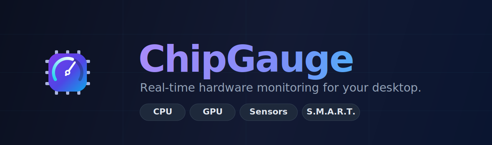
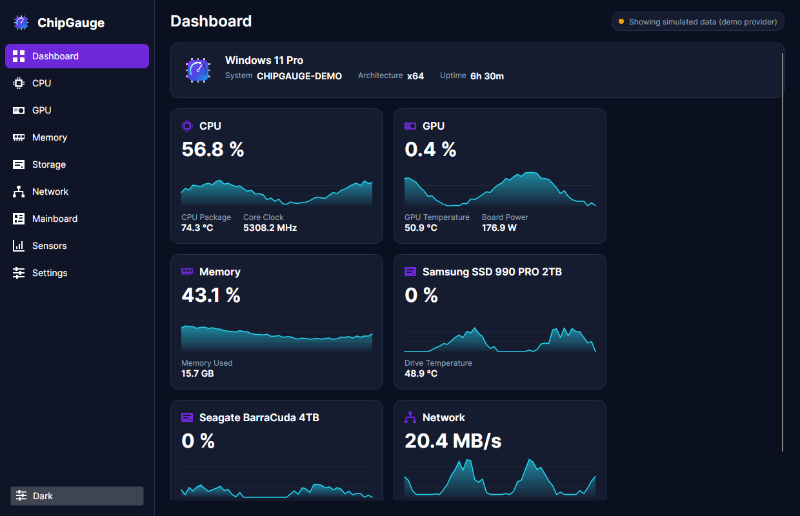
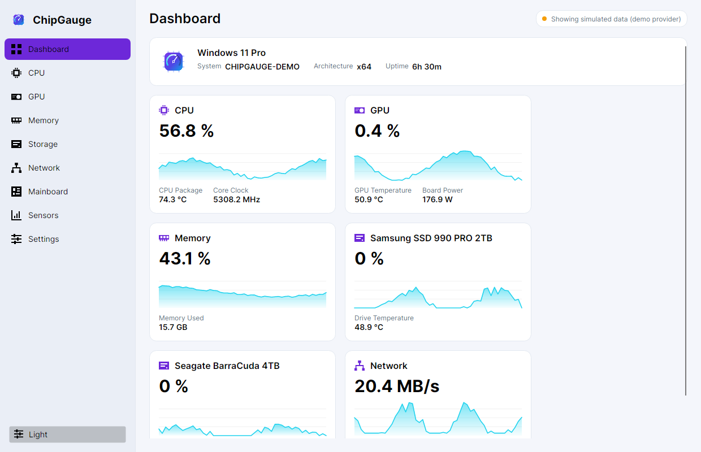
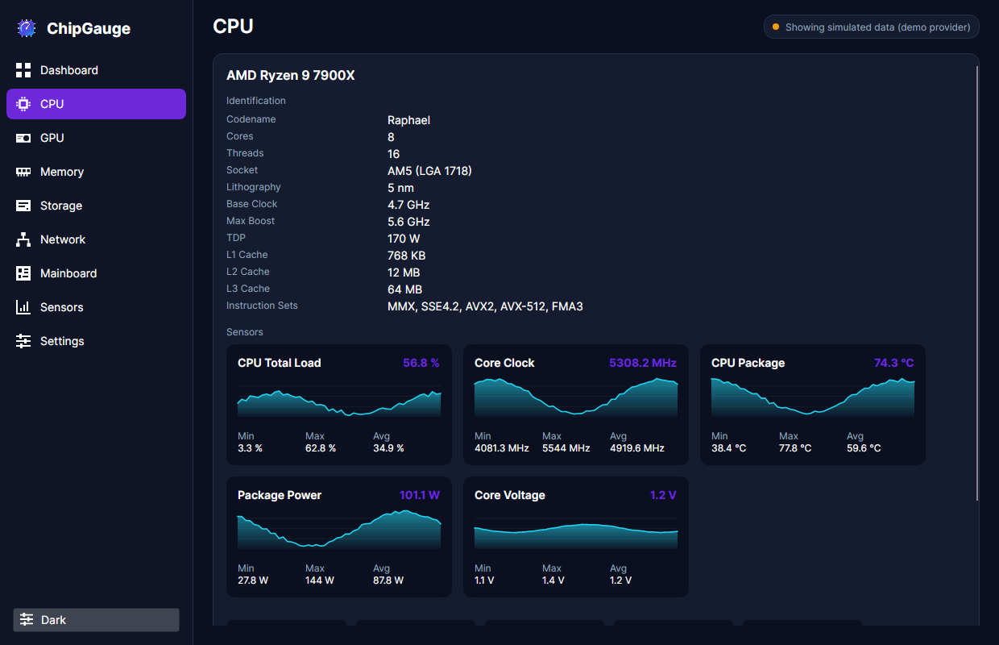
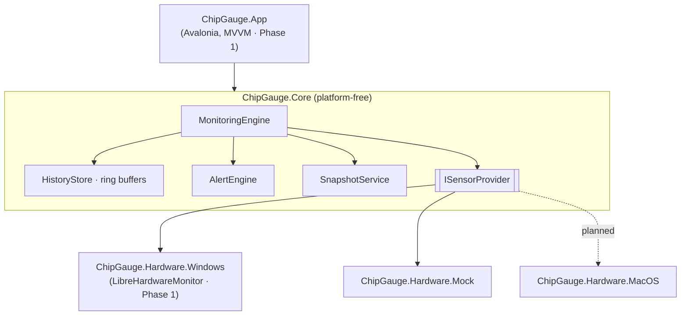

<div align="center">



# ChipGauge

**Real-time hardware monitoring for your desktop.**
One application that unifies what you'd otherwise open five tools to see —
CPU internals, GPU sensors, live performance graphs, full system inventory, and
drive health.

[](https://github.com/paradocx96/system-app/actions/workflows/ci.yml)
[](https://github.com/paradocx96/system-app/actions/workflows/codeql.yml)


-0EA5E9)


</div>

---

> **Project status — Phase 1 (Live MVP).**
> The Avalonia desktop app is up: a navigable shell, a live dashboard, per-category
> views, an HWiNFO-style sensor table, dark/light theming and full English/German
> localization — all driven by the monitoring engine through a simulated hardware
> provider. Next up is the live Windows sensor provider (LibreHardwareMonitor) so
> the same UI reads real hardware. See the [roadmap](#roadmap) and the full
> [architecture & development plan](docs/PLAN.md).

## Install

**Windows 10 / 11 (x64 or ARM64).** ChipGauge ships as a **self-contained,
single-file `.exe`** — the .NET runtime is bundled, so there's nothing else to
install.

1. Go to the [**Releases**](https://github.com/paradocx96/system-app/releases) page.
2. Download either:
   - `ChipGauge-<version>-win-x64.exe` — the portable app; just run it, or
   - `ChipGauge-<version>-win-x64.zip` — the same `.exe` zipped.
3. Double-click `ChipGauge.exe`. (Windows SmartScreen may warn on first launch
   until the binaries are code-signed — see [note](#a-note-on-releases).)

> There is no MSI/installer yet — that (plus auto-update) arrives with the
> Velopack packaging step. Until the live Windows sensor provider lands, the app
> shows **simulated** data.

### A note on releases

Releases are produced by the [`release`](.github/workflows/release.yml) workflow.
Binaries are **not code-signed yet**, so SmartScreen/antivirus may flag them on
first run — signing is a launch-blocking to-do tracked in the
[plan](docs/PLAN.md#11-risks--mitigations). Prefer building from source if that's
a concern.

## Screenshots

> Rendered from the app running on the simulated provider (deterministic demo data).

| Dashboard (dark) | Dashboard (light) |
|:---:|:---:|
|  |  |

| CPU category — identification + live sensor charts |
|:---:|
|  |

## Why ChipGauge

Enthusiasts and technicians juggle a drawer full of utilities: CPU-Z for CPU
identification, GPU-Z for the graphics card, CrystalDiskInfo for drive health,
HWiNFO64 for the full sensor list, Speccy for an inventory, and Task Manager for
the live graphs. ChipGauge brings all of that into **one modern, fast, themeable
application** with a summary dashboard, per-category deep dives, and live charts.

| Inspiration | What ChipGauge brings in |
|-------------|--------------------------|
| **CPU-Z** | CPU name, codename, socket, lithography, caches, instruction sets; board & memory details |
| **GPU-Z** | GPU identification, VBIOS/driver, clocks, VRAM usage, temperature, fan, board power |
| **CrystalDiskInfo** | Per-drive S.M.A.R.T. attributes, health verdict, temperature, power-on hours, TBW |
| **HWiNFO64** | The complete sensor tree with current / min / max / average and threshold alerts |
| **Speccy** | A single system inventory, exportable as a shareable snapshot report |
| **Task Manager** | At-a-glance dashboard tiles and 60-second scrolling performance graphs |

## Features

**Available now**

- 🖥️ **Desktop app** — Avalonia shell with a sidebar, a summary **dashboard** of live
  tiles, per-category views (CPU, GPU, Memory, Storage, Network, Mainboard) and an
  HWiNFO-style **sensor table** with search.
- 📈 **Live charts** — a custom, allocation-frugal scrolling area-chart control that
  renders the Task-Manager-style performance graphs from each sensor's history.
- 🎨 **Theming** — dark / light / system, theme-aware colors, and hover/press
  micro-interactions.
- 🌍 **Localization** — English + German (Deutsch), switchable **live** at runtime,
  with locale-aware number formatting (e.g. `42,5 °C`).
- ⚙️ **Monitoring engine** — background sampler with a pluggable provider seam, one
  batched update per tick, resettable min/max/average per sensor.
- 💽 **S.M.A.R.T. health** — CrystalDiskInfo-style Good / Caution / Bad verdict logic.
- 📝 **Snapshot export** — deterministic, culture-invariant system report.
- 🧪 **Mock provider** — a deterministic simulated machine for demos, screenshots
  and CI (no elevated hardware access required).

**Planned (next)**

- 🔌 Live **Windows** sensor provider (LibreHardwareMonitor) — real CPU/GPU/board/SMART data.
- 🚨 Alerts UI, tray mode, CSV logging, settings persistence.
- 📦 Velopack installer with delta auto-update; macOS provider.

## Architecture

Strict layering keeps hardware access out of the UI and platform code out of the
core — which is what makes the planned macOS port a new *provider*, not a rewrite.



Full rationale, the framework decision, and the screen-by-screen UI spec are in
[`docs/PLAN.md`](docs/PLAN.md).

## Tech stack

| Concern | Choice |
|---------|--------|
| Runtime | .NET 10 (LTS) |
| UI | Avalonia UI 12 · Fluent · Skia · CommunityToolkit.Mvvm |
| DI | Microsoft.Extensions.DependencyInjection |
| Sensors (Windows, next) | LibreHardwareMonitorLib + WMI |
| Tests | xUnit v3 · coverlet |
| CI/CD | GitHub Actions · CodeQL · Dependabot |
| Packaging (later) | Velopack (delta auto-update) |

## Project structure

```
ChipGauge.slnx
├── src/
│   ├── ChipGauge.Core/            # models, engine, history, alerts, SMART, reporting (no platform code)
│   ├── ChipGauge.Hardware.Mock/   # deterministic simulated provider
│   └── ChipGauge.App/             # Avalonia desktop UI (MVVM, views, live chart control, i18n)
│       # ChipGauge.Hardware.Windows (LibreHardwareMonitor provider) lands next
├── tests/
│   ├── ChipGauge.Core.Tests/      # engine, alerts, SMART, mock provider
│   └── ChipGauge.App.Tests/       # view-models + localization completeness
├── assets/                        # brand SVGs + generated icons/banner
├── build/                         # icon generation script
├── docs/                          # architecture & development plan
└── .github/workflows/             # CI, CodeQL
```

## Getting started

### Prerequisites

- [.NET 10 SDK](https://dotnet.microsoft.com/download/dotnet/10.0) (LTS)

### Build & test

```bash
git clone https://github.com/paradocx96/system-app.git
cd system-app

dotnet restore ChipGauge.slnx
dotnet build   ChipGauge.slnx -c Release
dotnet test    ChipGauge.slnx -c Release
```

### Run the app

```bash
dotnet run --project src/ChipGauge.App
```

The app currently runs on the simulated provider, so it works on any OS the
.NET 10 SDK supports — no elevation or real hardware access required.

### Check formatting (as CI does)

```bash
dotnet format ChipGauge.slnx --verify-no-changes
```

### Regenerate branding assets

```bash
pip install cairosvg Pillow
python3 build/generate-icons.py
```

## Internationalization

ChipGauge ships in **English** and **German (Deutsch)**, switchable at runtime.
All user-facing strings live in resource files; a CI check will fail the build if
a German translation is missing relative to English, so no string silently falls
back. Additional locales only require a new resource file.

## Roadmap

| Phase | Scope | Status |
|-------|-------|--------|
| **0 — Foundation** | Engine, ring buffers, mock provider, tests, CI, branding | ✅ Done |
| **1 — Live MVP** | App shell, theming, dashboard, category views, sensor table, i18n | ✅ Done (on mock data) |
| **1b — Live data** | Windows sensor provider (LibreHardwareMonitor), real readings | ⏳ Next |
| **2 — Categories** | Deeper per-category detail, per-core heatmap, memory SPD | 🔜 |
| **3 — Depth** | Full S.M.A.R.T. view, alerts UI, tray, CSV logging, settings persistence | 🔜 |
| **4 — Product** | Animations polish, installer + auto-update, code signing, v1.0 | 🔜 |
| **5 — macOS** | SMC/IOKit provider, notarized build | 🗺️ |

## Contributing

Contributions are welcome — see [CONTRIBUTING.md](CONTRIBUTING.md) for the build
loop, coding standards, and how the layers fit together. Please also read the
[Code of Conduct](CODE_OF_CONDUCT.md).

## Security

Found a vulnerability? Please follow the process in [SECURITY.md](SECURITY.md)
rather than opening a public issue.

## License

ChipGauge is a proprietary product — see [LICENSE](LICENSE). It builds on
third-party open-source components under their respective licenses (for example
LibreHardwareMonitorLib under MPL 2.0, used as an unmodified dependency).
