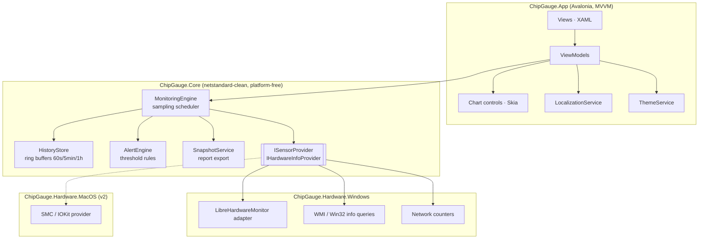

# ChipGauge — Architecture & Development Plan

> Real-time hardware monitoring for the desktop. Inspired by CPU-Z, Speccy, Windows Task
> Manager, HWiNFO64, GPU-Z, and CrystalDiskInfo — unified into one modern application.

| | |
|---|---|
| **Product name** | **ChipGauge** |
| **Domains** | `chipgauge.com` and `chipgauge.io` — both verified available (July 2026) |
| **Platform (v1)** | Microsoft Windows 10 (1809+) / Windows 11, x64 & ARM64 |
| **Platform (v2)** | macOS 13+ (Intel & Apple Silicon) |
| **License model** | TBD (proprietary product; some dependencies are MPL 2.0 — see §11) |

---

## 1. Product vision

One application that answers every "what is my machine doing right now?" question:

| Inspiration | What ChipGauge takes from it |
|---|---|
| **CPU-Z** | Deep CPU identification: name, codename, socket, lithography, caches, instruction sets, per-core clocks & multipliers; mainboard/BIOS info; memory type, channels & timings |
| **Speccy** | A single summary tree of the entire machine, exportable as a snapshot report |
| **Task Manager** | Live 60-second scrolling area charts per device, at-a-glance utilization percentages |
| **HWiNFO64** | The full sensor panel: every voltage, temperature, fan RPM, power and current with min / max / avg tracking, alerts |
| **GPU-Z** | GPU details: clocks, VRAM size/usage, driver & VBIOS version, sensors (temp, hotspot, fan, board power) |
| **CrystalDiskInfo** | SMART attributes per drive, health verdict, temperature, power-on hours, host writes (TBW) |

### UX pillars

1. **Dashboard first** — the main screen is a summary wall of live tiles (CPU, GPU, memory,
   each disk, network) with sparklines, mirroring Task Manager's performance overview.
2. **Category navigation** — a fixed sidebar: *Dashboard, CPU, GPU, Memory, Storage,
   Network, Mainboard, Sensors, Settings*. Selecting a category shows everything related
   to it (static identification + live charts + sensor readings).
3. **Modern & attractive** — Fluent 2 design language, dark/light theme with system
   detection, accent color, smooth chart animation and page transitions.
4. **Multilingual** — English and German (Deutsch) at launch, runtime-switchable,
   architecture ready for more locales.

---

## 2. Framework decision

### Requirements driving the choice

- Deep hardware sensor access on Windows (MSR reads, SMBus, embedded controller, NVMe/ATA
  SMART, NVIDIA NVML / AMD ADLX) — this is the make-or-break requirement.
- Cross-platform UI so the macOS port reuses the entire front-end.
- Real-time rendering: dozens of charts updating every second without stutter.
- Modern theming, animation, accessibility; small-enough footprint for a *monitoring* tool.

### Options evaluated

| Option | Sensors | Cross-platform UI | Verdict |
|---|---|---|---|
| **Avalonia UI + .NET (C#)** | ✅ **LibreHardwareMonitorLib** — the most complete OSS sensor stack in existence (successor of OpenHardwareMonitor; kernel-driver-backed MSR/SMBus access, SMART, NVML/ADL) is a .NET library — zero-friction integration | ✅ Windows, macOS, Linux from one XAML codebase; GPU-accelerated Skia renderer | ✅ **Chosen** |
| WinUI 3 (Windows App SDK) | ✅ same library | ❌ Windows-only — kills the macOS roadmap | ❌ |
| Tauri 2 (Rust + web UI) | ❌ Rust ecosystem (`sysinfo`) is shallow: no fan RPM, voltages, SMBus, per-core temps; we would have to build a driver-backed sensor stack from scratch | ✅ | ❌ |
| Electron + Node | ❌ needs native modules anyway; 300+ MB RAM for a *hardware monitor* is self-defeating | ✅ | ❌ |
| Qt 6 / C++ | ⚠️ possible but everything hand-rolled | ✅ | ❌ slower velocity, licensing complexity |

**Decision: .NET 10 (current LTS, supported to Nov 2028) + Avalonia UI 11.x.**
The sensor problem — the hardest problem in this product — is already solved in the .NET
ecosystem, and Avalonia gives us the future macOS build for free at the UI layer.

### Technology stack

| Concern | Choice | Notes |
|---|---|---|
| Runtime | **.NET 10 LTS** | self-contained publish, single-file, trimmed |
| UI framework | **Avalonia UI 11.x** | Fluent 2 theme, XAML, Skia rendering |
| MVVM | **CommunityToolkit.Mvvm** | source-generated observables & commands |
| DI / hosting | **Microsoft.Extensions.Hosting** | generic host, options, logging |
| Sensors (Windows) | **LibreHardwareMonitorLib** | CPU/GPU/board/fan/SMART/EC sensors |
| System info (Windows) | **WMI (System.Management)** + Win32 P/Invoke | OS, BIOS, devices, SPD fallback |
| Charts | **Custom Skia-drawn chart controls** (Task-Manager-style live charts) + **LiveCharts2** for rich analytical views | custom control keeps 1 s tick rendering allocation-free |
| Reactive plumbing | **System.Threading.Channels** + `IObservable` | engine → UI fan-out |
| Localization | **resx resources + custom `LocalizationService`** | `en`, `de`; runtime switch without restart |
| Persistence | JSON settings via `Microsoft.Extensions.Options` + [`System.Text.Json`] | `%AppData%/ChipGauge/settings.json` |
| Logging | **Serilog** (rolling file + debug sink) | |
| Unit tests | **xUnit v3** + NSubstitute + FluentAssertions | |
| UI tests | **Avalonia.Headless.XUnit** | view-model + view smoke tests |
| Packaging | **Velopack** | installer + delta auto-updates; MSIX evaluated later for Store |
| CI/CD | **GitHub Actions** | see §9 |
| Versioning | **MinVer** (SemVer from git tags) | |

---

## 3. Solution architecture

Strict layering — the UI never talks to hardware directly; the platform never leaks into
the core. This is what makes the macOS port a "new provider," not a rewrite.



### Project layout

```
ChipGauge.sln
├── src/
│   ├── ChipGauge.Core/                # domain models, engine, interfaces — NO platform code
│   │   ├── Models/                    # HardwareItem, Sensor, SensorKind, SmartAttribute…
│   │   ├── Monitoring/                # MonitoringEngine, HistoryStore, RingBuffer<T>
│   │   ├── Alerts/                    # AlertRule, AlertEngine
│   │   ├── Reporting/                 # SnapshotService (text/JSON export)
│   │   └── Abstractions/              # ISensorProvider, IHardwareInfoProvider, IClock
│   ├── ChipGauge.Hardware.Windows/    # LHM adapter, WMI queries, perf counters
│   ├── ChipGauge.Hardware.Mock/       # deterministic fake provider (dev on Linux/CI, demos, tests)
│   └── ChipGauge.App/                 # Avalonia UI
│       ├── Views/                     # DashboardView, CpuView, GpuView, …
│       ├── ViewModels/
│       ├── Controls/                  # LiveAreaChart, GaugeTile, SensorTree
│       ├── Services/                  # Localization, Theme, Navigation, Tray
│       ├── Assets/                    # logo, icons, fonts
│       └── i18n/                      # Strings.resx, Strings.de.resx
├── tests/
│   ├── ChipGauge.Core.Tests/
│   ├── ChipGauge.Hardware.Tests/
│   └── ChipGauge.App.Tests/           # Avalonia.Headless
├── build/                             # icon generation, packaging scripts
├── docs/
└── .github/workflows/
```

### Core domain model

- **`HardwareItem`** — a node in the hardware tree (`Cpu`, `Gpu`, `Memory`, `Storage`,
  `Network`, `Motherboard`, `Battery`, `Cooler`), with static `Properties`
  (identification: model, vendor, firmware…) and child **`Sensor`**s.
- **`Sensor`** — `{ Id, Name, Kind, Unit, Value, Min, Max, Avg }` where `Kind` ∈
  {Load, Clock, Temperature, Voltage, Current, Power, Fan, Flow, Throughput, Level, Data}.
- **`SensorSample`** — immutable `(SensorId, Timestamp, Value)` struct; what the engine emits.
- **`SmartDrive` / `SmartAttribute`** — CrystalDiskInfo-parity model: raw attributes,
  normalized/threshold values, computed health verdict (Good / Caution / Bad).

### Monitoring engine (the heart)

- Background service polls `ISensorProvider` on a configurable interval (default **1 s**,
  range 0.5–10 s), off the UI thread.
- Samples flow through a `Channel<SensorBatch>`; the UI subscribes and marshals to the
  dispatcher once per batch (one UI update per tick, not per sensor).
- **`HistoryStore`**: fixed-size ring buffers per sensor — 60 samples @ 1 s (Task-Manager
  window), plus downsampled 5-min and 1-h tiers for the analytics view. Allocation-free
  on the hot path.
- **Min/Max/Avg** tracked per sensor since app start, resettable (HWiNFO behavior).
- **`AlertEngine`**: user rules ("CPU temp > 90 °C for 10 s") → toast + tray notification.
- Elevation: LibreHardwareMonitor loads a signed kernel driver for MSR/SMBus access, so
  the app manifest requests `requireAdministrator` on Windows. A degraded non-admin mode
  (WMI/perf-counter data only) keeps the app usable if elevation is declined.

### Why `ChipGauge.Hardware.Mock` exists

A deterministic simulated provider (sine-wave loads, scripted SMART data) means:
UI development and screenshots don't need real elevated hardware access, CI on Linux
runners can run the full engine + headless UI test suite, and demos are reproducible.

---

## 4. UI / UX specification

### Shell

- **Sidebar** (icon + label, collapsible): Dashboard · CPU · GPU · Memory · Storage ·
  Network · Mainboard · Sensors · Settings.
- **Title bar**: custom-drawn (Fluent), theme toggle, language switcher, elevation badge.
- **Tray icon**: live mini-readout (CPU % / temp), quick toggles, "start minimized" mode.

### Screens

1. **Dashboard** — responsive grid of live tiles: CPU (load % + temp + clock sparkline),
   GPU (load + VRAM + temp), Memory (used/total + composition bar), one tile per physical
   disk (activity + health dot), Network (up/down sparklines), system summary card
   (OS, uptime, mainboard). Every tile navigates to its category on click.
2. **CPU** — CPU-Z-style identification block (name, codename, socket, TDP, lithography,
   caches L1/L2/L3, instruction sets) + Task-Manager-style utilization chart with
   per-logical-core heatmap grid, per-core clocks table, temperature/power charts.
3. **GPU** — GPU-Z parity: identification (GPU, VBIOS, driver, PCIe link), live charts for
   core/memory clock, load, VRAM usage, temperature (+hotspot), fan, board power.
4. **Memory** — usage chart, composition (in use / cached / committed), physical modules
   from SPD/WMI: size, type (DDR4/DDR5), speed, timings, vendor, part number, XMP/EXPO.
5. **Storage** — per drive: model, firmware, interface, partition map, capacity bar,
   activity/throughput charts, **full SMART table** with health verdict, temperature
   history, power-on hours, host writes.
6. **Network** — per adapter: link speed, IPs, MAC, driver; send/receive charts, totals.
7. **Mainboard** — board vendor/model/chipset, BIOS/UEFI version & date, voltages, fan
   headers with RPM charts, chipset/VRM temperatures.
8. **Sensors** — HWiNFO-style full tree of *every* sensor with current / min / max / avg
   columns, search/filter, pin-to-dashboard, CSV logging toggle.
9. **Settings** — theme (system/dark/light + accent), language (en/de), polling interval,
   temperature unit (°C/°F), startup & tray behavior, alert rules editor, data logging.

### Visual design

- Fluent 2 look: 8-px spacing grid, rounded corners, subtle acrylic-like translucency on
  the sidebar (where the OS supports it), Inter/Segoe UI Variable typography.
- **Charts**: filled area charts with gradient fade (Task-Manager aesthetic), 60-s
  scrolling window, ~200 ms eased tweening between samples; distinct per-category hues
  that hold contrast in both themes.
- **Animations**: page cross-fade + slight slide on navigation; tile hover elevation;
  number roll transitions on large readouts. All animations respect the OS
  "reduce motion" setting.
- **Branding assets to produce**: ChipGauge logotype + glyph (a chip outline fused with a
  gauge needle), SVG master → `.ico` (16–256 px) and `.icns`, tray icons (mono light/dark),
  README banner, installer sidebar art. Built via an SVG → multi-size render script in
  `build/` so assets regenerate reproducibly.

---

## 5. Internationalization

- All user-visible strings in `Strings.resx` (en, source of truth) + `Strings.de.resx`.
- `LocalizationService` exposes strings as a dynamic resource dictionary → **runtime
  language switching without restart**; culture also drives number/date/unit formatting
  (`de-DE`: `42,5 °C`).
- CI check: a test fails if any `de` key is missing relative to `en` (no silent English
  fallback creep).
- Rule for contributors: no hardcoded literals in XAML/view-models — enforced by an
  analyzer/test scanning for suspicious string usage.

## 6. Settings & persistence

- `settings.json` under `%AppData%/ChipGauge/` (versioned schema, forward-migratable).
- Sensor CSV logs (opt-in) under `Documents/ChipGauge/Logs/`.
- Crash/diagnostic logs via Serilog rolling files, 7-day retention.

## 7. Testing strategy

| Layer | Approach |
|---|---|
| `Core` | Pure unit tests: ring buffer semantics, downsampling, min/max/avg, alert rule evaluation, SMART health verdict logic, snapshot formatting — runs anywhere |
| `Hardware.Windows` | Thin adapter kept nearly logic-free; contract tests run against **recorded fixture data** (captured LHM trees serialized to JSON); a small smoke suite runs on the Windows CI runner |
| `App` | ViewModel tests with the **Mock provider** (navigation, tile composition, formatting, language switch); **Avalonia.Headless** render smoke tests per view; i18n completeness test |
| Static | `dotnet format --verify-no-changes`, analyzers as errors in CI |

Target: Core ≥ 90 % line coverage; every bug fix lands with a regression test.

## 8. Distribution & updates (Windows v1)

- `dotnet publish` self-contained, single-file, x64 + ARM64.
- **Velopack** builds the installer and serves **delta auto-updates** from GitHub Releases.
- Authenticode code signing (cert purchase = a launch-blocking TODO — unsigned binaries
  that load a kernel driver will trip SmartScreen/AV heuristics hard).
- In-app "Check for updates" + background update channel (stable / beta).

## 9. CI/CD — GitHub Actions

| Workflow | Trigger | Jobs |
|---|---|---|
| `ci.yml` | push / PR | **lint** (format + analyzers) → **test-linux** (Core + App headless tests on ubuntu-latest, fast) → **test-windows** (full suite incl. hardware adapter smoke on windows-latest) → upload coverage |
| `release.yml` | tag `v*` | publish x64/ARM64 → Velopack pack → sign → draft GitHub Release with installer + portable zip + SBOM |
| `codeql.yml` | schedule + PR | CodeQL security scanning |
| Dependabot | weekly | NuGet + Actions version bumps |

Branch protection on `main`: CI green + review required.

## 10. Roadmap

| Phase | Scope | Exit criteria |
|---|---|---|
| **0 — Foundation** (week 1) | Solution scaffold, Core engine + ring buffers, Mock provider, CI pipelines, logo/icon assets, README | CI green on Linux + Windows; engine unit-tested |
| **1 — Live MVP** (weeks 2–3) | Windows LHM provider, app shell (sidebar, theming dark/light), Dashboard with live CPU/Memory tiles + Skia chart control | Real sensors charting at 1 s on a real machine |
| **2 — Categories** (weeks 4–6) | CPU, GPU, Memory, Storage, Network, Mainboard views with identification + charts | Feature parity checklist vs CPU-Z/GPU-Z basics |
| **3 — Depth** (weeks 7–9) | Full SMART view (CrystalDiskInfo parity), HWiNFO-style Sensors tree with min/max/avg, alerts, tray mode, CSV logging, snapshot export (Speccy parity) | Power-user validation pass |
| **4 — Product polish** (weeks 10–12) | German localization complete, animations/transitions, settings, Velopack installer + auto-update, code signing, docs site on chipgauge.com | **v1.0 public release** |
| **5 — macOS** (post-1.0) | `Hardware.MacOS` provider (SMC/IOKit, Apple Silicon sensors), .icns/menu-bar UX, notarized .dmg | v2.0 |

## 11. Risks & mitigations

| Risk | Impact | Mitigation |
|---|---|---|
| Kernel-driver + unsigned binary → AV/SmartScreen flags | Users can't install | Code-sign from day one of distribution; use LHM's signed driver; document clearly |
| LibreHardwareMonitorLib is **MPL 2.0** | License obligations for a commercial product | MPL is file-level copyleft — keep it as an unmodified NuGet dependency (fine for proprietary apps); publish any patches to the library itself |
| Sensor coverage gaps on exotic boards | Missing readings, support burden | Degrade gracefully (hide absent sensors), in-app "report my hardware" snapshot to grow fixtures |
| HWiNFO-level depth is years of reverse-engineering | Scope creep | Parity target for v1 = LHM's coverage (already excellent); depth grows incrementally |
| macOS sensor access differs completely (SMC, no LHM) | Port cost | Interfaces designed provider-first from day 0; Mock provider proves the seam works |
| Real-time charts × dozens of sensors → jank | Poor UX in a perf tool | Custom allocation-free Skia control, one batched UI update/tick, perf budget test in CI |

## 12. Immediate next steps

1. Register `chipgauge.com` + `chipgauge.io` (both verified available, ~$49/yr total).
2. Phase 0 scaffold: solution, Core + Mock provider + tests, CI, assets, README.
3. Phase 1: Windows sensor provider + live dashboard.
